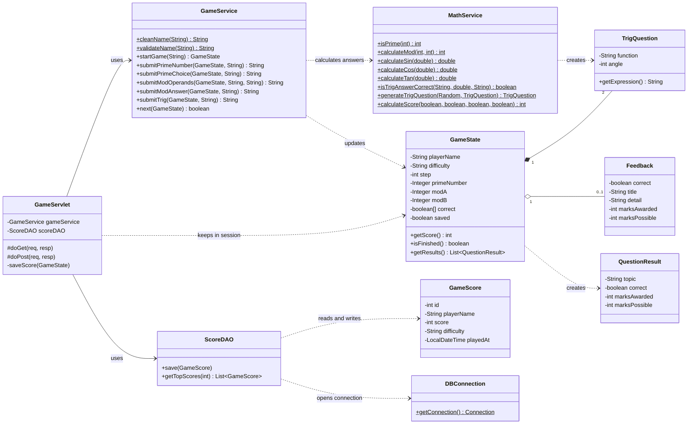
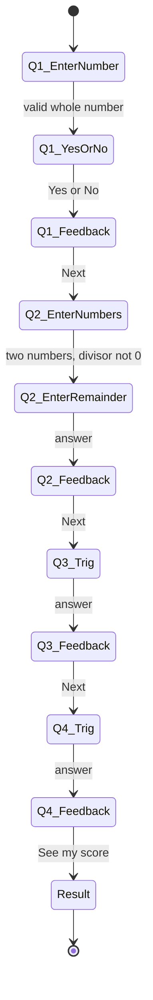
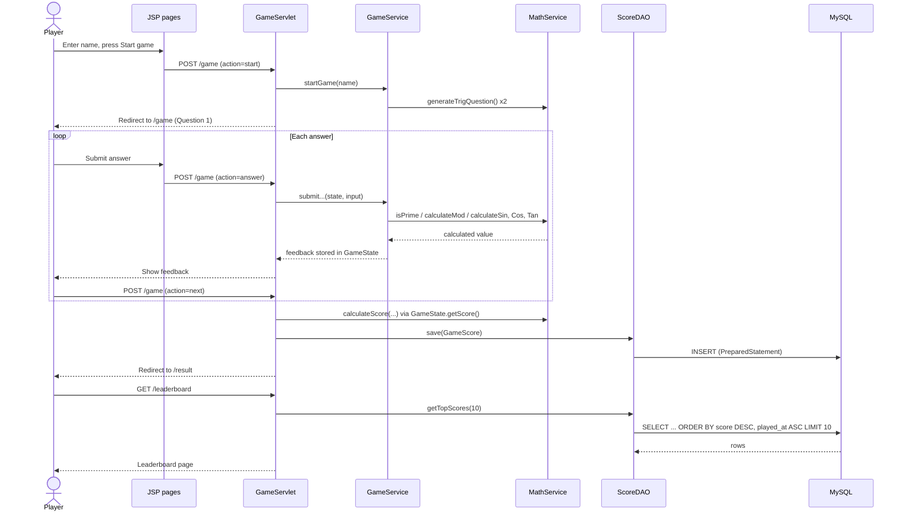

# ATIK – MATH WHIZ

A web-based maths game built with **Java Servlets, JSP and JDBC (MySQL)**. Players enter their name, answer four maths questions one at a time, see their final score, and appear on a Top 10 leaderboard.

Every answer is checked by real Java methods. No answers are stored in advance.

## Project objectives

- Write reusable Java methods for prime numbers, modulus and trigonometry.
- Check every answer with Java calculations.
- Handle requests and responses with a Servlet and show pages with JSP.
- Save and read scores with JDBC and `PreparedStatement`.
- Show a sorted Top 10 leaderboard.
- Document and publish the project on GitHub.

## Features

- Questions appear one after another, with instant feedback after each one.
- Running score and a progress bar while playing.
- Trigonometry questions use common angles. Sometimes `tan(90°)` or `tan(270°)` appears, where the correct answer is *undefined*.
- Scores are saved with player name, score, difficulty and date/time.
- Top 10 leaderboard, sorted by score (highest first), then by time (earliest first).
- Light, graph-paper themed design that works on phones and desktops.

## Technologies used

| Area | Technology |
|------|------------|
| Language | Java 17 |
| Web | Jakarta Servlet 6, JSP 3.1, JSTL 3 |
| Server | Apache Tomcat 10.1+ (or the built-in embedded Tomcat) |
| Database | MySQL 8 with JDBC (MySQL Connector/J) |
| Build | Maven (WAR packaging) |
| Testing | JUnit 5 |
| Front end | HTML and CSS |

## Software requirements

| Software | Version |
|----------|---------|
| JDK | 17 or newer |
| Apache Tomcat | 10.1 or newer (optional, see "Run the application") |
| MySQL | 5.7 or 8.x |
| Maven | 3.8 or newer (IntelliJ includes it) |

> Tomcat 9 will not work. This project uses the `jakarta.*` packages.

## Project structure

```
MathWhiz/
├── src/main/java/
│   ├── controller/GameServlet.java     start, answer, next, result and leaderboard requests
│   ├── launcher/Main.java              runs the game with an embedded Tomcat (IDE use only)
│   ├── model/                          GameScore, GameState, TrigQuestion, Feedback, QuestionResult
│   ├── service/MathService.java        isPrime, calculateMod, calculateSin/Cos/Tan, scoring
│   ├── service/GameService.java        moves the game from step to step
│   └── dao/                            DBConnection, ScoreDAO (JDBC)
├── src/main/resources/db.properties    database settings
├── src/main/webapp/
│   ├── index.jsp  game.jsp  result.jsp  leaderboard.jsp
│   ├── css/style.css
│   └── WEB-INF/                        web.xml, shared header and footer
├── src/test/java/service/MathServiceTest.java
├── database/math_whiz_db.sql
├── screenshots/
├── pom.xml
└── README.md
```

## UML diagrams

The diagrams use Mermaid, which GitHub shows as pictures automatically.

### Class diagram



### Game steps



### Sequence diagram: playing a game



## Database configuration

1. Start MySQL.
2. Create the database and table:

   ```bash
   mysql -u root -p < database/math_whiz_db.sql
   ```

3. Open `src/main/resources/db.properties` and set your MySQL user and password:

   ```properties
   db.url=jdbc:mysql://localhost:3306/math_whiz_db?useSSL=false&allowPublicKeyRetrieval=true&serverTimezone=UTC&characterEncoding=UTF-8
   db.user=root
   db.password=root
   ```

### Database creation SQL

```sql
CREATE DATABASE IF NOT EXISTS math_whiz_db
    CHARACTER SET utf8mb4
    COLLATE utf8mb4_unicode_ci;

USE math_whiz_db;

CREATE TABLE IF NOT EXISTS game_scores (
    id          INT AUTO_INCREMENT PRIMARY KEY,
    player_name VARCHAR(100) NOT NULL,
    score       INT          NOT NULL,
    difficulty  VARCHAR(20)  NOT NULL DEFAULT 'NORMAL',
    played_at   TIMESTAMP    NOT NULL DEFAULT CURRENT_TIMESTAMP,
    INDEX idx_leaderboard (score, played_at)
);
```

Leaderboard query used by the application:

```sql
SELECT id, player_name, score, difficulty, played_at
FROM game_scores
ORDER BY score DESC, played_at ASC
LIMIT 10;
```

## Run the application

First finish the database setup above. Then choose one option.

### Option 1: Run from the IDE (no Tomcat install needed)

1. Open the project folder (the one that contains `pom.xml`) as a Maven project in IntelliJ IDEA.
2. Wait for Maven to import the dependencies.
3. Open `src/main/java/launcher/Main.java` and click the green Run button next to `main`.
4. Open **http://localhost:8080/MathWhiz/**

### Option 2: Deploy a WAR file to Tomcat

1. Build the WAR file:

   ```bash
   mvn clean package
   ```

2. Copy `target/MathWhiz.war` into Tomcat's `webapps/` folder.
3. Start Tomcat (`bin/startup.bat` on Windows, `bin/startup.sh` on Linux and macOS).
4. Open **http://localhost:8080/MathWhiz/**

### Run the unit tests

```bash
mvn test
```

### Change the title

The title shown on every page is the `appTitle` value in `src/main/webapp/WEB-INF/web.xml`.

## Game rules and scoring system

The game asks four questions, one after another. After each question you see whether you were right.

| Question | Topic | What the player does | Marks |
|----------|-------|----------------------|-------|
| Q1 | Prime number | Types a number, then answers Yes or No: is it prime? | 2 |
| Q2 | Modulus | Types two numbers (the divisor can't be zero), then types the remainder | 2 |
| Q3 | Trigonometry | Gives sin, cos or tan of an angle | 3 |
| Q4 | Trigonometry | Gives sin, cos or tan of an angle | 3 |
| | | **Total** | **10** |

Rules:

- **Prime:** `isPrime(int)` returns 1 for a prime and 0 otherwise. Numbers below 2 are not prime.
- **Modulus:** `calculateMod(int, int)` uses `%`. The divisor must not be zero. Negative numbers follow Java's `%` rule.
- **Trigonometry:** angles are in degrees and converted to radians before `Math.sin()`, `Math.cos()` and `Math.tan()` are used. A decimal answer is accepted within ±0.01. Fractions such as `1/2` also work.
- **Undefined values:** for `tan(90°)` and `tan(270°)` the correct answer is *undefined*. Press the Undefined button or type it.
- **Difficulty:** every question is `NORMAL`. The value is saved in the database.

Scoring logic:

```java
int totalScore = 0;

if (primeCorrect) totalScore += 2;
if (modCorrect)   totalScore += 2;
if (trig1Correct) totalScore += 3;
if (trig2Correct) totalScore += 3;
```

## Main Java methods

```java
public static int isPrime(int number)
public static int calculateMod(int a, int b)
public static double calculateSin(double degree)
public static double calculateCos(double degree)
public static double calculateTan(double degree)   // NaN when undefined
```

## Test cases

| Test case | Expected result |
|-----------|-----------------|
| Prime input 7 | 1 |
| Prime input 8 | 0 |
| Prime input 1 | 0 |
| Modulus 17 % 5 | 2 |
| Sine 30° | 0.5 |
| Cosine 60° | 0.5 |
| Tangent 45° | 1.0 |
| Divisor 0 | Validation error |
| All answers correct | 10 marks |
| Incorrect answers | Those marks are not awarded |

These are covered by `MathServiceTest.java`.

## Application screenshots

### Welcome Page


### Game Page


### Result Page


### Leaderboard


## GitHub project directory link

```
https://github.com/<username>/<repository>/tree/main/MathWhiz
```

## Author

**Atik**
